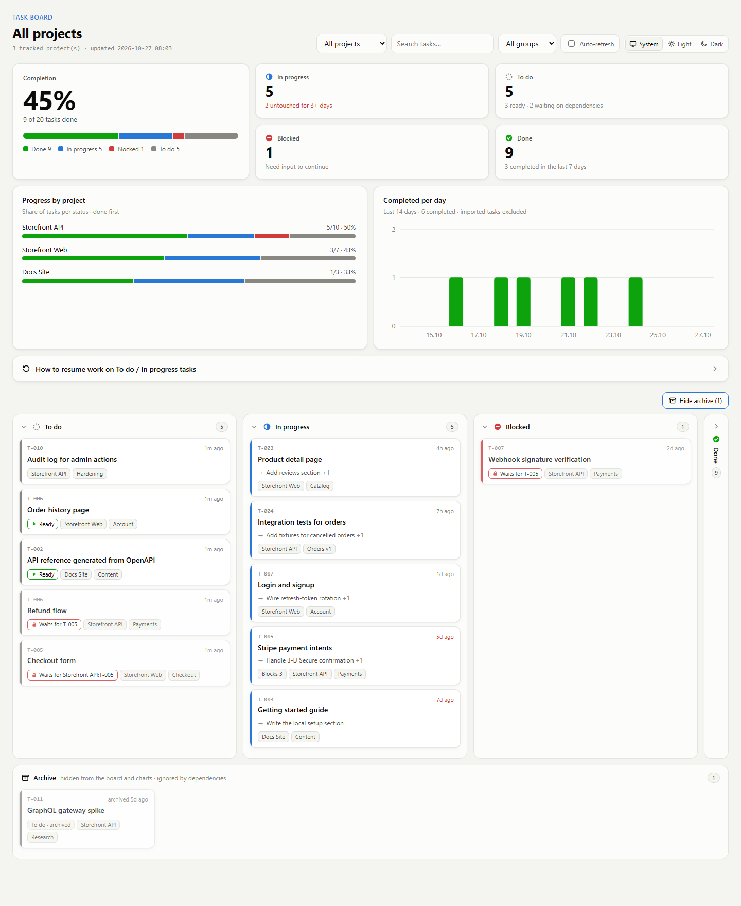

# rafal-tools

A collection of **skills for [Claude Code](https://claude.com/claude-code)**, Anthropic's AI coding assistant. They ship as one plugin, `rafal-tools`, through a plugin marketplace of the same name.

A **skill** is a packaged set of instructions, plus optional scripts and templates, that Claude loads when a task calls for it. Once the plugin is installed, Claude uses these skills on its own when your request matches them. You can also call a skill directly with a slash command in the form `/rafal-tools:<skill-name>`.

**Skills:** [task-tracker](plugins/rafal-tools/README.md#task-tracker) · [plugin-cost](plugins/rafal-tools/README.md#plugin-cost) · [security-audit](plugins/rafal-tools/README.md#security-audit)

**Contents:** [Skills](#skills) · [Install](#install) · [Repository layout](#repository-layout) · [Adding a new skill](#adding-a-new-skill) · [Updating the screenshots](#updating-the-screenshots) · [Design principles](#design-principles) · [License](#license)

## Skills

| Skill | Command | What it does |
|---|---|---|
| **task-tracker** | `/rafal-tools:task-tracker` | Tracks tasks and progress per project folder, with an HTML Kanban board for all projects. It imports progress from existing markdown plans, supports dependencies between tasks (also across projects), keeps its data outside the repos, and resumes unfinished work while loading as few tokens as possible. [Details](plugins/rafal-tools/README.md) |
| **plugin-cost** | `/rafal-tools:plugin-cost` | Reports how many tokens each enabled plugin adds to every session (skill descriptions plus text injected by its hooks, which `claude plugin details` does not count) and how often each plugin and skill was really used in the last 30 days, based on local session history. It finishes with concrete cleanup suggestions: plugins never used, plugins used in only a few projects, and duplicate scopes. It runs only on demand and never changes settings by itself. [Details](plugins/rafal-tools/README.md#plugin-cost) |
| **security-audit** | `/rafal-tools:security-audit` | Audits your own web, mobile and desktop apps for security holes, phase by phase: recon, a test plan mapped to OWASP controls, a code scan with free scanners (each candidate verified in code), localhost verification with a test account per role, optional abuse/load checks, and a prioritized English report. Outputs stay in the app's `.security/` folder; dynamic tests run only against your own hosts, and passwords never reach the report. [Details](plugins/rafal-tools/README.md#security-audit) |

Run `/rafal-tools:task-tracker` with no arguments to see the tracker's status and every available action.



*The task-tracker board, shown with sample data. More screenshots are in the [plugin README](plugins/rafal-tools/README.md#board).*

## Install

Requirements: Claude Code and Node.js 18+ on `PATH`. The scripts have no npm dependencies.

From a local clone:

```
/plugin marketplace add C:/path/to/this/folder
/plugin install rafal-tools@rafal-tools
```

From GitHub:

```
/plugin marketplace add rafalfbacc-tech/rafal-tools
/plugin install rafal-tools@rafal-tools
```

(the full git URL `https://github.com/rafalfbacc-tech/rafal-tools.git` works too)

Restart Claude Code afterwards, so that the skills and their hooks load.

The same steps work from the terminal: `claude plugin marketplace add <source>` and `claude plugin install rafal-tools@rafal-tools`.

### Update

After changing files in this folder, bump `version` in both manifests (see below), then run:

```
claude plugin marketplace update rafal-tools
claude plugin update rafal-tools@rafal-tools
```

Restart Claude Code to apply the update.

Claude Code runs a plugin from a **copy in its cache** (`~/.claude/plugins/cache/rafal-tools/rafal-tools/<version>/`), not from this folder. That has two consequences:
- **Without a version bump, nothing changes.** If `plugin update` reports "not found", reinstall with `claude plugin uninstall rafal-tools@rafal-tools` followed by `claude plugin install rafal-tools@rafal-tools`.
- **Sessions that were already open keep the old copy until they restart.** That includes their hooks and scripts. The task-tracker board carries a version stamp, so an old session can no longer overwrite a board made by a newer version.

## Repository layout

```
.claude-plugin/marketplace.json        marketplace "rafal-tools" (lists the plugins below)
docs/make-screenshots.mjs              regenerates the README images from sample data
plugins/rafal-tools/
├── .claude-plugin/plugin.json         plugin "rafal-tools" (name, version, description)
├── hooks/hooks.json                   Claude Code hooks used by the skills
├── README.md                          user documentation for the skills
├── docs/screenshots/                  README images (next to the README so every Markdown viewer can load them)
└── skills/
    ├── plugin-cost/
    │   ├── SKILL.md                   instructions for the cost report
    │   └── scripts/plugin-cost.mjs    measures plugin cost and reads session history
    └── task-tracker/
        ├── SKILL.md                   instructions Claude loads when the skill is used
        ├── references/                extra instructions, loaded only when needed
        ├── scripts/tt.mjs             CLI the skill drives
        └── templates/board.html       HTML board template
```

## Adding a new skill

1. Create `plugins/rafal-tools/skills/<skill-name>/SKILL.md` with frontmatter:
   ```markdown
   ---
   name: <skill-name>
   description: What it does and when Claude should use it (this text is always loaded, so keep it short).
   ---
   ```
2. Put scripts, templates and rarely needed instructions next to it, in `scripts/`, `templates/` and `references/`. Keep `SKILL.md` small, because it is loaded in full every time the skill is used.
3. Add a row to the **Skills** table above and document the skill in `plugins/rafal-tools/README.md`.
4. Bump `version` in `plugins/rafal-tools/.claude-plugin/plugin.json` and `.claude-plugin/marketplace.json`, then run `claude plugin validate .` and the update steps above.

The new skill becomes available as `/rafal-tools:<skill-name>`.

## Updating the screenshots

After a change to the board's look, run this from the repo root:

```
node docs/make-screenshots.mjs
```

The script works in a temporary folder and never touches your real tracker data or config. It:

1. builds English sample data (three projects, about 20 tasks, dependencies within and across projects, two weeks of activity);
2. renders the board with the current template;
3. captures the four images in `plugins/rafal-tools/docs/screenshots/` with headless Edge or Chrome;
4. deletes the temporary folder.

If no browser is found automatically, pass `--browser "<path to msedge/chrome>"` or set the `BROWSER` env var.

## Design principles

- **Low token cost:** short skill descriptions, a small `SKILL.md`, and details in `references/` files that load only when needed. Hooks print as little as possible.
- **Nothing written into your projects:** skill data lives outside the repositories you work on.
- **No dependencies:** plain Node.js scripts and static HTML.

## License

MIT — see [LICENSE](LICENSE). Copyright (c) 2026 Rafal Musialski.
