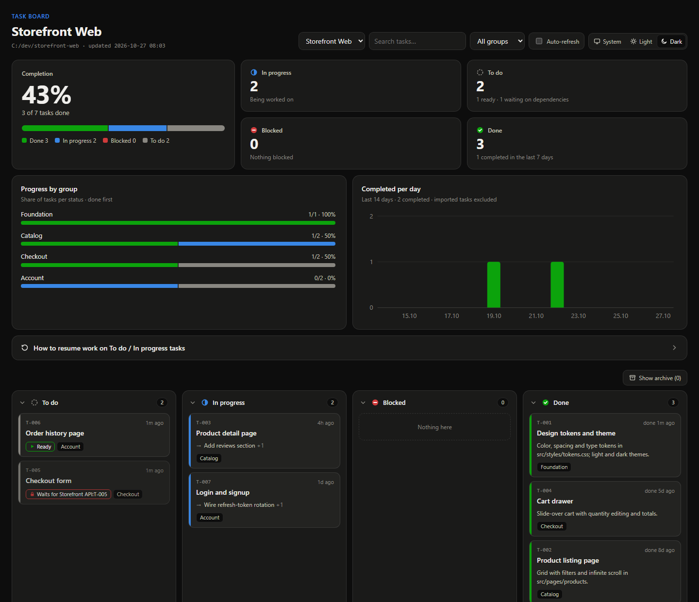
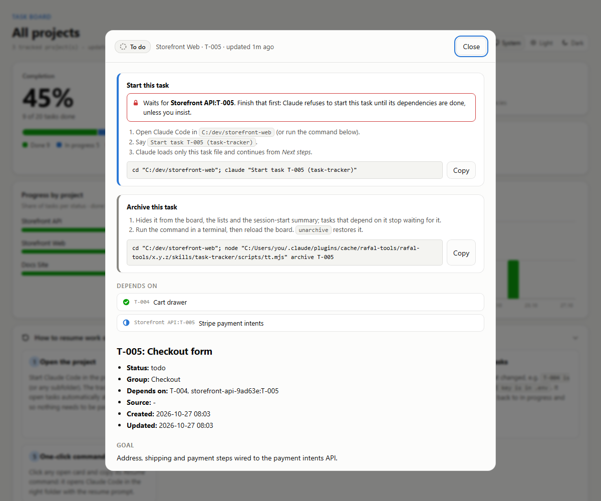
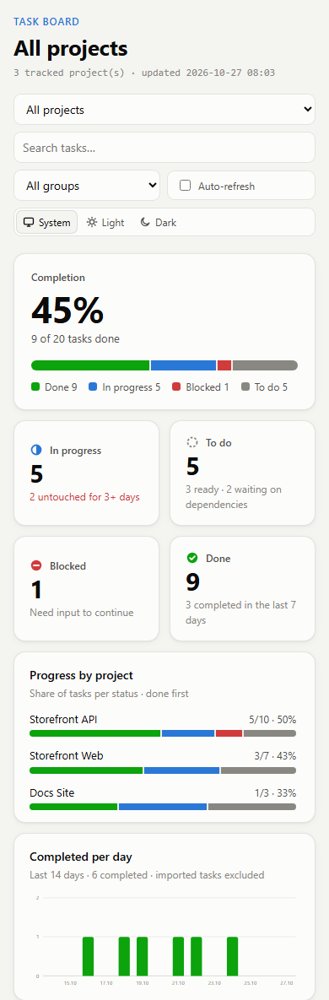

# rafal-tools

A Claude Code plugin with skills, invoked as `/rafal-tools:<skill>`.

## Skills

| Skill | Command | What it does |
|---|---|---|
| [task-tracker](#task-tracker) | `/rafal-tools:task-tracker` | Task tracking per project folder with an HTML board, import of progress from markdown plans, dependencies, and token-cheap resume |
| [plugin-cost](#plugin-cost) | `/rafal-tools:plugin-cost` | Per-session token cost and real usage of every enabled plugin, with cleanup suggestions |
| [security-audit](#security-audit) | `/rafal-tools:security-audit` | Phase-by-phase security audit of your own web, mobile and desktop apps, ending in a prioritized report |

**Contents:** [Requirements](#requirements) · [Install](#install)
- **[task-tracker](#task-tracker):** [Features](#features) · [Hooks](#hooks) · [Resuming To do / In progress tasks](#resuming-to-do--in-progress-tasks) · [Board](#board) · [Cross-project dependencies](#cross-project-dependencies) · [Where the data and board live (config)](#where-the-data-and-board-live-config) · [Quick help](#quick-help) · [Config file](#config-file)
- **[plugin-cost](#plugin-cost)**
- **[security-audit](#security-audit):** [Phases](#phases) · [Output and safety](#output-and-safety)

## Requirements

Node.js 18+ on `PATH`. No npm dependencies.

## Install

```
/plugin marketplace add rafalfbacc-tech/rafal-tools
/plugin install rafal-tools@rafal-tools
```

## task-tracker

Command: `/rafal-tools:task-tracker`

Tracks tasks and progress across many projects. It renders an HTML Kanban board and lets a new session resume unfinished work without re-reading whole plans.

### Features

- **Opt-in per folder:** say "track this" (or "track C:\path\to\project") and every request in that folder becomes tracked work.
- **Import existing progress:** on first tracking, Claude scans the project's markdown files (checkboxes, `Status:` lines). It creates open tasks for unfinished work and done tasks with a "Work done" summary for finished work.
- **Dependencies:** tasks can depend on other tasks (`tt dep`, or `"deps"` when importing a plan). A task waits until its dependencies are done, Claude will not start it early, and finishing a task announces what just became ready.
- **One file per task:** an implementation plan with 9 tasks becomes 9 task files. On resume only the open-task list is loaded, plus the one task being continued.
- **Data outside the repo:** everything lives in `~/.claude/task-tracker/`, or wherever `TASK_TRACKER_HOME` points. Nothing is written into your projects.
- **One board for all projects:** a read-only page with a project switcher, Kanban columns, search, a group filter and auto-refresh. Ask Claude to "open the board".

### Hooks

| Hook | Behaviour (only in tracked folders) |
|---|---|
| SessionStart | Prints the compact list of open tasks so work can resume immediately |
| UserPromptSubmit | Short reminder to record the request as task(s) |
| Stop | Blocks once if no task update was recorded this turn |

### Resuming To do / In progress tasks

1. Start Claude Code in the project folder or any subfolder. The open tasks are listed automatically at session start.
2. Say what to continue:
   - `continue` resumes the first In progress task.
   - `resume T-003` resumes a specific task.
   - `start T-005` begins a To do task.
   - `T-004 is unblocked: <what changed>` moves a blocked task back to work.
3. Claude loads only that one task file (goal, notes, next steps, log) and carries on from its next steps.
4. On the board, click an open card and copy its **Resume** command. It opens Claude Code in the right folder with the resume prompt, for example:
   `cd "C:/path/to/project"; claude "Resume task T-003 (task-tracker)"`

### Board

The board is one read-only HTML page for all tracked projects. It contains:

- a completion figure and a status breakdown;
- tiles per status (in-progress tasks untouched for 3+ days are flagged);
- progress bars per group or per project;
- a completed-per-day chart for the last 14 days;
- a built-in "how to resume" guide;
- the Kanban columns. Click a column header to collapse it to a narrow strip (remembered per browser);
- a **Show archive** button that reveals archived tasks in a separate section.

The **System / Light / Dark** switch follows the OS theme by default. A manual choice is remembered in that browser.

All screenshots below use sample data.

**All projects:** status overview, charts, and cards with dependency chips (*Waits for*, *Ready*, *Blocks N*). The *Done* column is collapsed to a strip, and *Show archive* lists an archived task below the columns.


**One project, dark theme:** progress per group. Tasks that wait for another project are marked (*Waits for Storefront API:T-005*).



**Task details:** a one-click resume command, a warning about unfinished dependencies, a copyable archive command, clickable dependency links (also across projects), and the full task file.



**Mobile:** the layout adapts down to phone width.



### Cross-project dependencies

A task can wait for a task in another tracked project: `T-005 depends on backend:T-002`. The prefix is the project name or its folder name. Waiting tasks are not started early. Finishing the backend task announces that the frontend task is ready, and the board links both ways.

### Archive

`archive T-003` (CLI: `tt archive <ID>...`) hides a task of any status from the lists, the session-start summary, the board columns and the charts. An archived task no longer holds up the tasks that depend on it, so archiving can make them ready. `unarchive T-003` restores it. On the board, **Show archive** lists archived tasks; `tt list --archived` does the same in the terminal.

### Where the data and board live (config)

The location is resolved in this order:

1. the `TASK_TRACKER_HOME` env var;
2. `"dataDir"` in `~/.claude/task-tracker.config.json`;
3. the default `~/.claude/task-tracker/`.

Commands:

- `tt config` shows the current location and where it comes from.
- `tt move <dir>` moves all data and the board to a new folder (for example a synced drive). It verifies the copy, updates the config and removes the old folder; add `--keep-old` to keep it.
- `tt config set dataDir <dir>` points at a folder that already holds tracker data, without copying anything.

### Quick help

Run `/rafal-tools:task-tracker` with no arguments to get the current status and every available action with example phrases.

### Config file

`~/.claude/task-tracker.config.json` is created on the first `init`:

```json
{
  "resumeLimit": 5,
  "dataDir": "D:/Sync/tasks"
}
```

| Key | Default | Meaning |
|---|---|---|
| `resumeLimit` | `5` | Open tasks listed at session start. In-progress and blocked tasks are always listed; the rest of the todo tasks is summarized as `+N more todo`. Lower = fewer tokens per session. |
| `dataDir` | `~/.claude/task-tracker` | Where data and the board live. Set it with `tt move` (moves the data) or `tt config set dataDir` (repoints only). |

## plugin-cost

`/rafal-tools:plugin-cost` (or ask "how many tokens do my plugins cost?") prints a report like this:

```
PLUGIN COST REPORT · 2026-10-25 · usage window: last 30 days, 33 sessions

Per-session cost of enabled plugins (in context before your first message)
Plugin                                 Skills    Hook  Session  /prompt  Invoked  Scripts  Sessions  Last used
peters-toolkit@peters-toolkit           ~2.1k      ~0    ~2.1k        -       28        7     14/33  2026-10-24
superpowers@claude-plugins-official      ~848    ~851    ~1.7k        -       44      338     17/33  2026-10-25
rafal-tools@rafal-tools                   ~88      ~0      ~88        -        1       21      2/33  2026-10-25
Total                                                    ~3.9k

Most expensive skills when invoked
Skill                                           On invoke  Invoked (30d)
peters-toolkit:sproc-xray                          ~31.0k           0
...

Findings
- superpowers@claude-plugins-official is enabled 2 times (project:C:\...; user). One enabled scope is enough; ...
- Heavy skills never used in 30 days: ...
```

The columns:

- **Skills:** skill and agent descriptions that are always in context (from `claude plugin details`).
- **Hook:** text that the plugin's SessionStart hooks inject into every session. `claude plugin details` does not count it, so the script runs the hooks in an empty temporary folder and measures their output.
- **/prompt:** text that UserPromptSubmit hooks add to every message.
- **Invoked / Scripts / Sessions / Last used:** real usage, read from local session history in `~/.claude/projects`. *Invoked* counts skill, agent and slash-command uses; *Scripts* counts shell commands running the plugin's own scripts.

Options:

- `--days N` sets the usage window.
- `--here` runs the hooks in the current folder instead of an empty one, which shows folder-specific injections such as the task-tracker list (SessionStart hooks then run there for real; UserPromptSubmit hooks still run in an empty folder, so they cannot change state such as the tracker's turn marker).
- `--no-hooks` skips running other plugins' hooks.

The report never changes settings. Claude suggests commands such as `claude plugin disable <plugin> --scope user`, and you decide whether to run them.

## security-audit

Command: `/rafal-tools:security-audit <phase>`

Audits **your own** applications — web/SaaS/API, mobile, desktop — for security holes and produces a prioritized, agent-fixable report. It detects the project type and loads only the matching checklist. Designed around two goals: few false positives (every finding has a traced data path and can be confirmed on localhost) and low token use (phases run separately, scanner output is filtered by a script, and only the files the plan points at are read).

### Phases

Run one phase per invocation; each writes a file the next one reads.

| Phase | What it does |
|---|---|
| `init` | Recon: detects stack, entry points, auth, data stores and platforms; writes `recon.md` and a `config.yaml` template |
| `plan` | Turns the attack surface into numbered, prioritized test goals mapped to OWASP controls (`test-plan.md`) |
| `scan [area\|--changed]` | Runs free scanners, verifies each candidate in code, and records findings with a source→sink trace |
| `verify` | Starts the app on localhost, logs in per role, and reproduces findings (authorization, injection, auth bypass) |
| `stress` *(optional)* | Security-oriented abuse/load: rate limits, resource exhaustion, race conditions |
| `report` | Prioritized English report with a coverage matrix |
| `status` | Which phases are done and the next command |

### Output and safety

- All files live in `<app repo>/.security/` (`config.yaml`, `recon.md`, `test-plan.md`, `findings.md`, `tools/`, `report.md`). `init` adds `.security/` to `.gitignore`.
- **Config** holds the local URL and start command, a **scope allowlist** of hosts dynamic tests may hit (default `localhost`), and **one test account per role** for authorization testing.
- **Own apps only:** dynamic tests refuse any host outside the scope allowlist; never production, never third-party hosts.
- **Backup gate:** before any data-changing test, the skill checks that a test-database backup exists and only proceeds after you confirm or approve making one.
- **Passwords never appear** in any output file or report — findings refer to roles. Reports are English; the skill talks to you in your language.
- **Tools** (gitleaks, osv-scanner, semgrep, trivy, OWASP ZAP, nuclei, …) are installed only when their license allows free use; a tool that is unavailable is listed in the report's coverage matrix instead of silently skipped.
